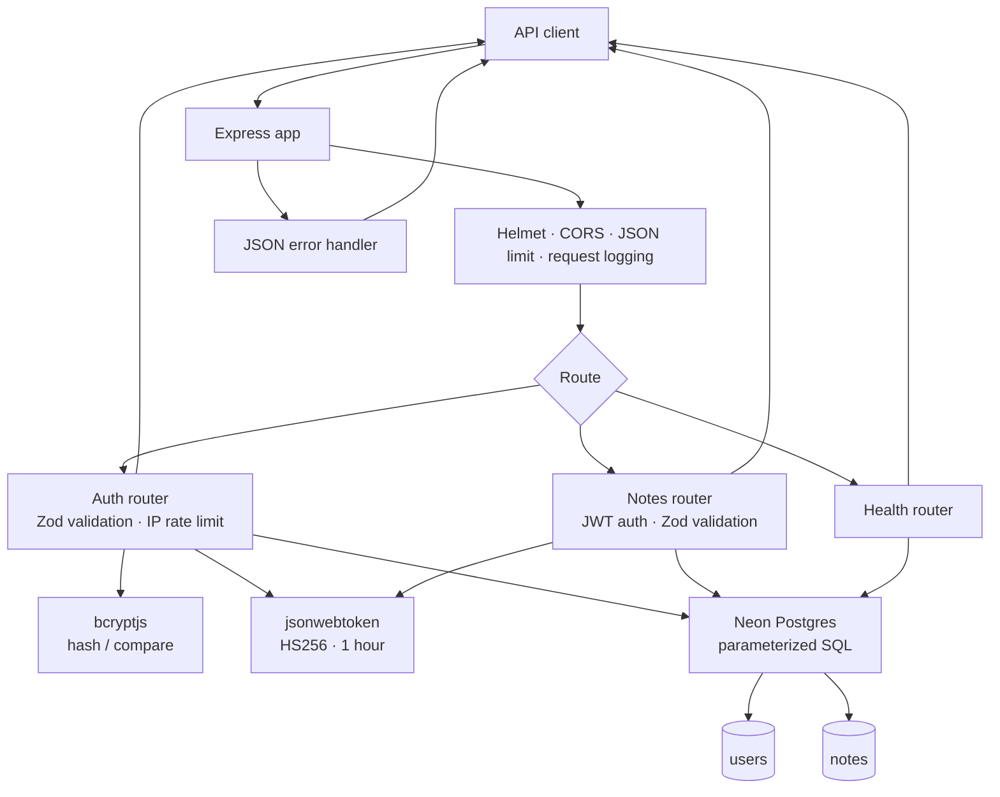
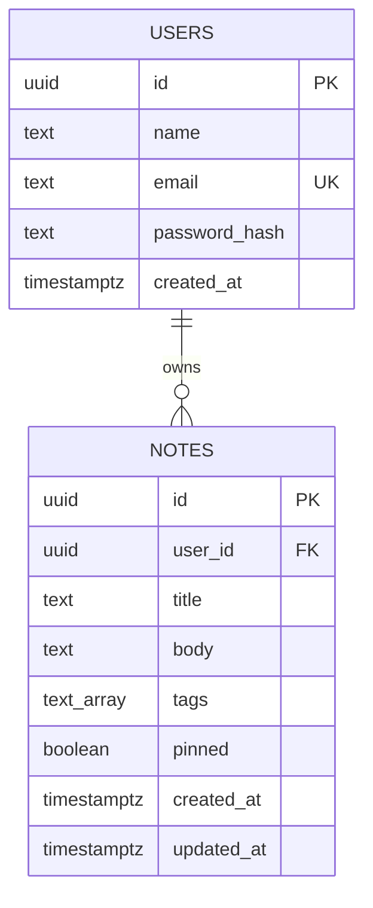

# Notes API — Case Study

## Overview

Notes API is a REST API for creating accounts and managing private, user-owned notes. Built with Node.js 20, Express 5, and Neon Postgres, it combines account registration and login with one-hour JWT bearer authentication, note CRUD, tags, pinning, search, and pagination. The API source is in [`abdulrahmanjamiu221-cmd/12-notes-api`](https://github.com/abdulrahmanjamiu221-cmd/12-notes-api). **Live demo:** [Portfolio showcase](https://jamiu-portfolio.vercel.app/) — this is the portfolio site, not a deployed API endpoint; no live API URL is documented in the project repository.

## Problem → Solution

**Problem:** A notes service needs to let different users manage their notes without exposing another user's data, while providing useful organization and retrieval features.

**Solution:** The API authenticates users with signed JWTs and scopes note reads, updates, and deletes to the authenticated user ID. It supports tag and pinned filters, text search, and pagination, with request validation and consistent JSON error responses.

## Features

- Register and log in with normalized email addresses and hashed passwords.
- Retrieve the authenticated account with `GET /api/auth/me`.
- Create, list, search, filter, retrieve, update, and delete notes.
- Add tags and pin notes; pinned notes sort first, followed by most recently updated.
- Paginate note lists with a default page size of 20 and a maximum of 100.
- Check service and database connectivity at `GET /api/health`.
- Run API integration tests against a separate Neon test branch.

## Screenshots

The repository is an API and does not include a browser UI. Replace these placeholders with screenshots from an API client (for example, VS Code REST Client) if you want visual evidence.

## Tech Stack — and Why

| Technology | Role | Why it fits this project |
| --- | --- | --- |
| Node.js 20 (ES modules) | Runtime and module system | Provides a straightforward JavaScript runtime for an API and the built-in test runner used by the project. |
| Express 5 | HTTP server, middleware, and route handling | Keeps health, authentication, and note endpoints organized as focused routers with shared middleware. |
| Neon Postgres and `@neondatabase/serverless` | Persistent relational data | Stores users and notes with foreign-key ownership and uses Neon’s serverless SQL client from the application. |
| `bcryptjs` | Password hashing and verification | Stores password hashes rather than plaintext passwords; hashing uses cost factor 12. |
| `jsonwebtoken` | Bearer-token authentication | Issues signed, expiring JWTs for authenticated API requests without storing session state in the API process. |
| Zod | Request validation | Checks request bodies, note IDs, and list query parameters before they reach database operations. |
| Helmet, CORS, and `express-rate-limit` | HTTP security middleware | Adds security headers, restricts browser origins, and limits repeated authentication attempts. |
| `node:test` and Supertest | Integration testing | Exercises HTTP routes and authorization behavior without requiring a separately running HTTP server. |

## Architecture

Registration validates and normalizes the email, hashes the password, inserts a user, and returns a signed token. Login verifies the password hash before issuing a token. Protected note routes verify the token, take the user ID from its `sub` claim, and include that ID in every note query.

## Data Model

Each note belongs to one user. Deleting a user cascades to that user's notes. Tags are stored as a PostgreSQL `text[]`.

## Security Considerations Implemented

- Passwords are hashed with `bcryptjs` at cost 12; API responses use explicit public-user fields and omit `password_hash`.
- JWTs are signed with HS256, contain the user ID in `sub`, and expire after one hour. Verification explicitly permits HS256 and rejects missing, malformed, or expired bearer tokens with `401` and `WWW-Authenticate`.
- Configuration fails fast if the PostgreSQL URL is invalid, the JWT secret is missing or shorter than 32 characters, or the port is invalid.
- SQL values are passed through Neon tagged-template queries rather than concatenated into SQL strings.
- Note queries always scope access by the authenticated `user_id`. Create derives ownership from the verified token; attempts to access another user's note return `404`.
- Zod validation rejects invalid body fields, UUIDs, and list filters with `422` responses.
- Authentication routes are limited to 10 attempts per IP per 15 minutes. Helmet, an explicit CORS origin list, and a 100 KB JSON body limit are enabled.
- Production errors use a generic message for server failures.
- Integration tests require a separate `TEST_DATABASE_URL` and refuse to run when its Neon endpoint matches `DATABASE_URL`.

**Deployment note:** CORS currently allows the two localhost development origins. Add the actual frontend origin before using browser-based requests from a deployed site. Keep `.env` and all production secrets out of version control; the JWT payload is signed, not encrypted.

## Challenges and What I Learned

- **Enforcing ownership consistently:** The note routes include the authenticated user ID in their database queries. This demonstrates that authentication alone is not enough; authorization must also be enforced at the data-access boundary.
- **Keeping credentials out of responses:** Registration and login return only public user fields, while password hashes remain internal to authentication.
- **Handling flexible list queries safely:** Search, tag and pinned filters, and pagination are validated and represented as parameterized query values.
- **Testing without touching development data:** A distinct Neon test branch and an endpoint check make test isolation an explicit requirement, rather than relying on convention alone.

## Future Improvements

- Deploy the API and replace the portfolio-only link above with a real health-check or API demo URL.
- Move allowed CORS origins into validated environment configuration for deployment.
- Add refresh-token rotation or a revocation strategy if longer-lived sessions are needed.
- Expand integration tests to cover note creation, updates, deletion, validation failures, list filters, and pagination boundaries.
- Add OpenAPI documentation and CI checks for tests and formatting.
- Use a shared rate-limit store if the API is scaled across multiple server instances.
